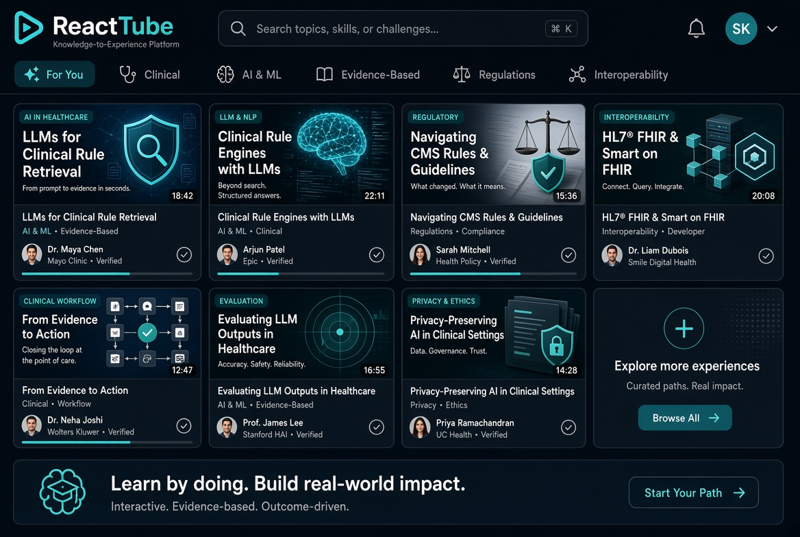
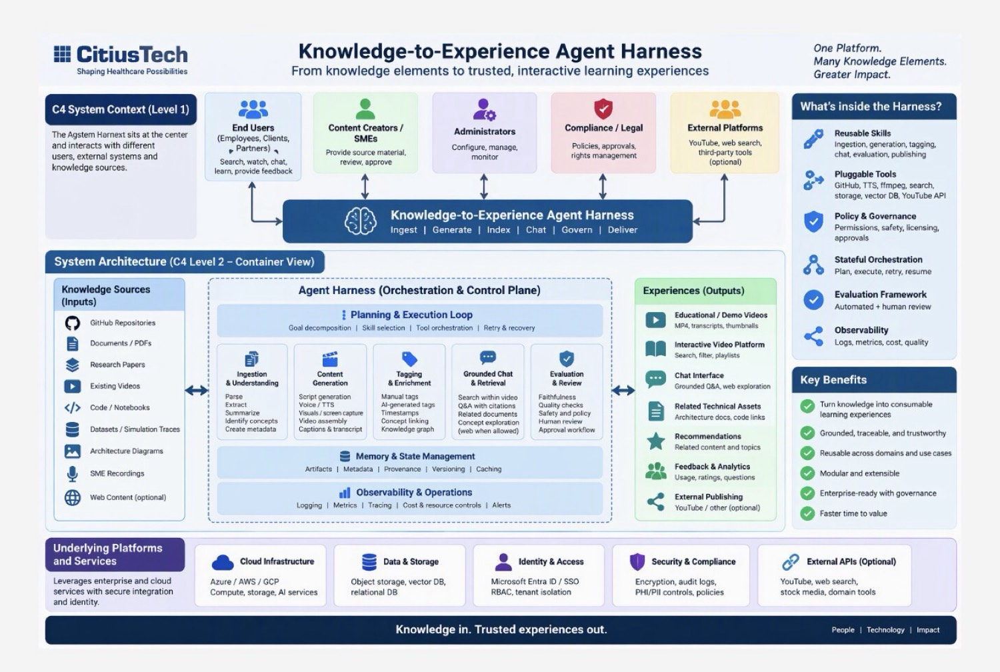

# Knowledge-to-Experience Agent Harness

**From knowledge elements to trusted, interactive learning experiences.**

One Platform. Many Knowledge Elements. Greater Impact.

This repository is the open starting point for a reusable, modular **Knowledge-to-Experience (K2E) Agent Harness**.
It turns source material — GitHub repositories, papers, documents, PowerPoint, or videos — into polished short educational/demo videos (1–2 minutes, in the spirit of 3Blue1Brown), rich metadata, tags, and an interactive consumption experience with grounded chat.

Inspired by enterprise agent harness concepts (e.g., CitiusTech-style Knowledge-to-Experience diagrams) and modern agentic pipelines.

## See the Interface in Action

[](https://raw.githubusercontent.com/YPCC/knowledge-to-experience-harness/main/videos/harness_interface_demo_v1.mp4)

Watch the ~45-second demo of the React mini-platform (search, tags, player + transcript, grounded chat) using the clinical pathways paper as the source example.

## Architecture



C4-style context and container view of the harness: knowledge sources → agent orchestration (ingest, generate, index, chat, govern, deliver) → experiences (videos, platform, chat). Includes reusable skills, pluggable tools, policy & governance, evaluation, and observability.

## Why This Exists

- Turn raw technical/business knowledge into consumable, visual, trusted learning experiences.
- Grounded, traceable, and governable (no invented PHI or proprietary data).
- Modular so individual stages (ingest, script, voice, visuals, tagging, platform) can be run independently.
- Searchable mini-YouTube-style browser + chat (grounded in transcripts + optional web exploration).
- Integrable with Grok or similar models for chat over the content.

## Core Pipeline

1. **Source Ingestion** — GitHub repo / video URL / paper / docs / PPTX / PDF → structured summary + candidate video topics.
2. **Video Generation** — Scripts (overview, deep-dive, dialogue, short explainer, how-it-works) → multi-speaker voice → visuals + ffmpeg assembly → MP4 + MP3 + timestamped transcript.
3. **Tagging & Metadata** — Manual + AI tags, short description, key timestamps, concept links, JSON metadata record. Provenance tracked (source commit/URL, prompts, settings).
4. **Chat Interface** — Grounded Q&A over transcripts (jump to timestamps, cite source sections). Separate concept-exploration chat that can browse the web.
5. **Consumption Platform** — Professional React (Vite + TypeScript) filterable video browser (search, tags). Playback + transcript + grounded chat side-by-side. Can grow or publish to YouTube.

## Code Review with Open Code Review

Use the skill at `skills/open-code-review/` to review **any** Git repository (this harness, the CMS source, platform code, or external repos) with [alibaba/open-code-review](https://github.com/alibaba/open-code-review).

- Install: `npm install -g @alibaba-group/open-code-review`
- Configure LLM once: `ocr config provider` / `ocr config model`
- Invoke via the skill or directly: `ocr review --audience agent --background "context" --format json`
- Supports workspace changes, branch diffs, single commits, or full `ocr scan`
- Groups findings by severity; integrates with the evaluation framework

See `skills/open-code-review/SKILL.md` for the full workflow.

## Example Videos

### 1. Knowledge-to-Experience Harness Itself (Meta Overview)

**What is the Knowledge-to-Experience Agent Harness?** (~63 seconds)  
Clean overview of the modular pipeline: knowledge sources → agent harness → searchable educational videos + grounded chat platform.

<video src="https://github.com/YPCC/knowledge-to-experience-harness/raw/main/videos/k2e_harness_overview_v1.mp4" controls width="100%"></video>

[Download / view raw](https://github.com/YPCC/knowledge-to-experience-harness/raw/main/videos/k2e_harness_overview_v1.mp4)

This is the first video generated by the harness — explaining the harness.

### 2. Example Series Generated from Another GitHub Repository

Source: [cms-policy-as-code](https://github.com/YPCC/cms-policy-as-code) (Neuro-Symbolic CMS Policy-as-Code / Context Graph Engine)

#### CMS Policy-as-Code: From Unstructured Documents to Auditable Rules (~59s)
<video src="https://github.com/YPCC/knowledge-to-experience-harness/raw/main/videos/cms_policy_overview_v1.mp4" controls width="100%"></video>
[Download](https://github.com/YPCC/knowledge-to-experience-harness/raw/main/videos/cms_policy_overview_v1.mp4)

#### Why Policy-as-Code Matters for Healthcare Payers (~47s)
<video src="https://github.com/YPCC/knowledge-to-experience-harness/raw/main/videos/cms_policy_business_v1.mp4" controls width="100%"></video>
[Download](https://github.com/YPCC/knowledge-to-experience-harness/raw/main/videos/cms_policy_business_v1.mp4)

#### Neuro-Symbolic Architecture Explained (~53s)
<video src="https://github.com/YPCC/knowledge-to-experience-harness/raw/main/videos/cms_policy_architecture_v1.mp4" controls width="100%"></video>
[Download](https://github.com/YPCC/knowledge-to-experience-harness/raw/main/videos/cms_policy_architecture_v1.mp4)

#### How a Claim Becomes a Decision Trace (~42s)
<video src="https://github.com/YPCC/knowledge-to-experience-harness/raw/main/videos/cms_policy_howitworks_v1.mp4" controls width="100%"></video>
[Download](https://github.com/YPCC/knowledge-to-experience-harness/raw/main/videos/cms_policy_howitworks_v1.mp4)

All videos are also registered in `platform/public/videos.json` for the React mini-platform (search, filter, transcript, grounded chat).

## Short Plan — First Batch of Videos (Meta: Explaining the Harness Itself)

| # | Title | Type | Length | Focus | Status |
|---|-------|------|--------|-------|--------|
| 1 | What is the Knowledge-to-Experience Harness? | Overview | 60–90s | High-level value, inputs → outputs | Generated |
| 2 | Inside the Agent Harness (C4 Level 2) | Technical deep-dive | 90–120s | Planning loop, ingestion, generation, chat, evaluation | Planned |
| 3 | From GitHub Repo to 90-Second Explainer | How-it-works | 60–90s | End-to-end walkthrough on a sample public repo | Planned |
| 4 | Grounded Chat + Mini YouTube | Demo | 60s | Searching, timestamp jumps, Grok-style interaction | Platform live |
| 5 | 3Blue1Brown-Style Visual Principles | Style guide | 60s | Clarity, visual metaphor, progressive disclosure | Skill doc ready |

Additional specialized videos have been generated for the first real source (CMS Policy-as-Code) — see the Example Videos section above.

## Operating Principles

- Prefer synthetic or publicly available source material.
- Always emit reusable artifacts: scripts, transcripts, metadata JSON, intermediate audio.
- Version and provenance for every generated video.
- Modular skill documents for voice, visual style, captioning, branding.
- When a new GitHub link is provided, produce a short plan (candidate videos + outline) before generating assets.

## Repository Structure (evolving)

```
/
├── README.md
├── docs/
│   ├── images/                 # Architecture diagrams and thumbnails
│   ├── skills/                  # Reusable skill documents
│   │   ├── voice.md
│   │   ├── visual-style.md
│   │   └── tagging.md
│   ├── sources/                 # Per-source plans
│   ├── ingestion-path.md
│   ├── evaluation-framework.md
│   ├── grok-integration.md
│   ├── youtube-publish-notes.md
│   └── generation-log.md
├── platform/                  # React mini-YouTube (Vite + TS)
│   ├── public/videos.json        # Static metadata loader
│   └── src/App.tsx
├── scripts/                    # Generation & utility stubs
│   ├── ingest_stub.py            # PPTX/PDF → candidate plan
│   └── youtube_oauth_stub.py
├── skills/                   # Agent skills (e.g. open-code-review)
│   └── open-code-review/         # AI code review for any Git repo
├── videos/                    # Example generated videos (embedded above)
└── artifacts/                  # Additional generated files (large files may be gitignored)
```

## Next Steps (updated)

- [x] Flesh out skill documents (voice, visual style matching 3B1B clarity, tagging).
- [x] Implement first ingestion + script generation on a public GitHub source (cms-policy-as-code).
- [x] Generate sample 60-second overview video (harness + multiple CMS videos).
- [x] Scaffold professional mini-platform (React/Vite instead of Streamlit) with transcript search + grounded chat.
- [x] Research YouTube upload / API and Grok integration points.
- [x] Evaluation framework for clarity and technical accuracy.
- [x] Add open-code-review skill for reviewing any code repository.

**Current status**: Harness is operational. Architecture diagram embedded. Interface demo video embedded with thumbnail. Harness overview + four CMS videos generated and embedded. Open Code Review skill added for quality checks on any repo. Ready for next source or deeper motion/Manim upgrades.

## Tech Notes

- Visuals: slide-based + generated imagery + ffmpeg (Manim-style where feasible).
- Voice: multi-speaker TTS (see docs/skills/voice.md).
- Chat: grounded on transcripts + optional external search (clearly labeled).
- Platform: React (Vite + TypeScript) mini-YouTube with search, tags, player, transcript, and chat.
- Code review: alibaba/open-code-review via the skill in `skills/open-code-review/`.

**Knowledge in. Trusted experiences out.**

People | Technology | Impact
